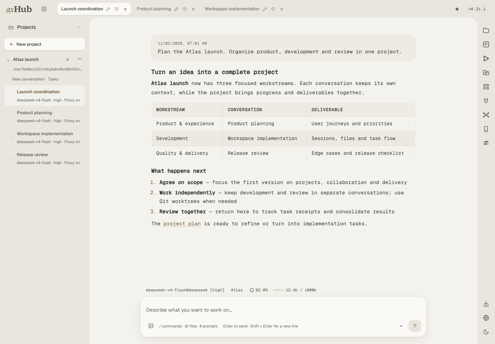
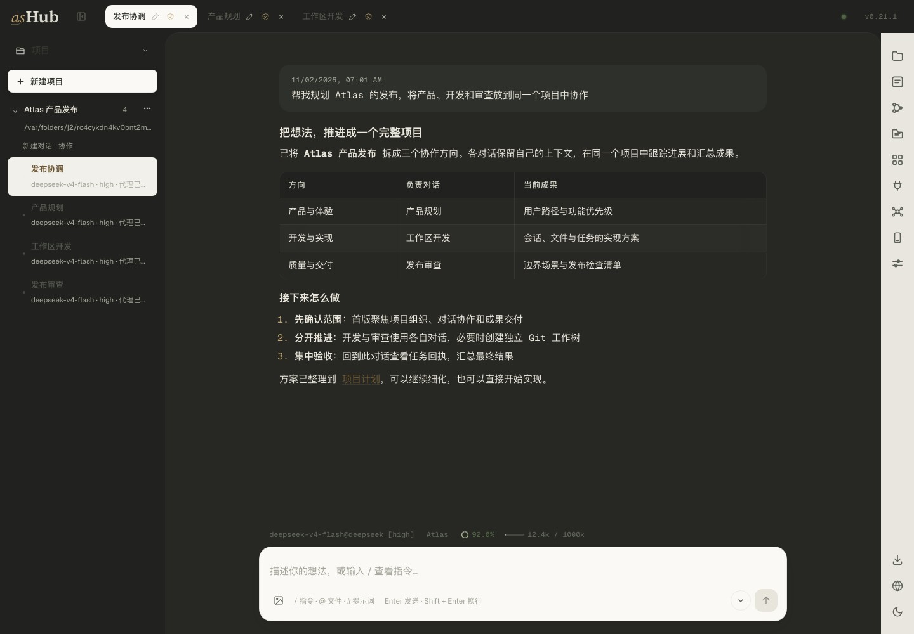
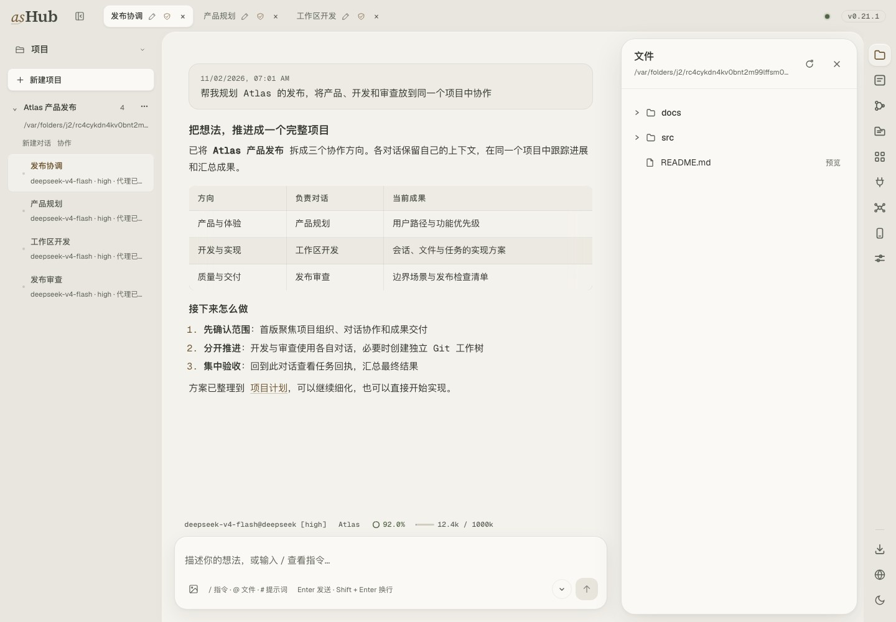

<p align="center"></p>
<h1 align="center">asHub</h1>
<p align="center">A quiet workspace for ambitious ideas</p>
<p align="center"><a href="https://ashub.aihao.world">Website & downloads</a> · <a href="https://github.com/firslov/asHub/releases">Releases</a> · <a href="README.md">English</a> · <a href="README_CN.md">简体中文</a></p>

[](LICENSE)
[](.nvmrc)
[](https://www.npmjs.com/package/agent-sh/v/0.17.0)

asHub is an open-source desktop workspace powered by [agent-sh](https://github.com/guanyilun/agent-sh). Keep conversations, models, subagents, terminals and project files together, with a readable result and an inspectable execution trail.

Available for **macOS (Apple Silicon / Intel), Windows x64 and Linux x64**. The desktop app and local browser view share the same client. Connect your own model provider with API credentials or supported Codex sign-in; provider billing and plan limits apply.



*English workspace screenshot from v0.21.1, using isolated demo data.*

## Highlights

**[v0.21.9](https://github.com/firslov/asHub/releases/tag/v0.21.9)** updates the agent-sh kernel to 0.17.0 and improves long-running tasks, Personal Assistant memory, and device interconnect.

- **Subagents:** cancelled, partial, and completed runs are distinct in live views and history. Transient stream failures retry the current model request and keep completed tool results. Continuing a subagent in the same conversation reuses its original task and results within its original permissions.
- **Personal Assistant:** search authorized conversation excerpts alongside saved memories, choose a separate model for background organization, and optionally build project decision overviews that point back to their evidence. The plugin is installed separately.
- **Device interconnect:** see which computer is running the task, return to the device list, and resync a slow conversation without losing the draft or automatically resending a message.

| Capability | Experience |
| --- | --- |
| Sessions & projects | Create and delete conversations within projects; sort sessions by recent activity, search, pin, archive and restore history |
| Conversation collaboration | Send tasks, follow receipts, supplement work and surface blockers to the coordinator; optional Git worktrees isolate changes |
| Readable execution | Replies and progress first; thinking and tool output stay in expandable details |
| Tasks & subagents | Task progress and five specialists: plan, explore, review, research and implement; configurable models and budgets |
| Models & context | Codex sign-in, model search and native thinking levels; inspect context and reported cache usage |
| Reviewable actions | Permission prompts, change previews, session-wide approval and background notifications |
| Project tools | PTY terminals, file browsing, image input, inline image previews and a skills marketplace |
| Plugins | Enable included extensions or import trusted ZIPs; configure, disable, uninstall and restore |
| Background mode | Keep tasks and remote access running when windows close; reopen or quit from the tray |
| Proxy controls | Choose a global proxy default and override it per conversation |
| Persistent work | Saved conversations, branches, rewind, Markdown export and downloadable workspace results |
| A consistent interface | Warm light and graphite dark themes; English and Chinese; display scaling and a collapsible status bar |
| Device interconnect · preview | Continue authorized conversations on another computer or in the mobile web app |

<details>
<summary>Dark workspace</summary>



</details>

<details>
<summary>Project files</summary>



</details>

## Install & get started

Download from the [website](https://ashub.aihao.world/#download) or [GitHub Releases](https://github.com/firslov/asHub/releases/latest). Desktop packages include their runtime; no separate Node.js installation is needed.

| Platform | Package |
| --- | --- |
| macOS Apple Silicon | `arm64.dmg` |
| macOS Intel | `x64.dmg` |
| Windows x64 | `Setup.exe` |
| Linux x64 | `.AppImage` |

1. Install and open asHub
2. Configure your provider and default model in the right panel, or use supported Codex sign-in
3. Create a session, choose a project directory and start a conversation; open files, terminals and other panels as needed

### macOS one-line install

```sh
curl -fsSL https://raw.githubusercontent.com/firslov/asHub/main/install.sh | bash
```

The script detects Apple Silicon or Intel, installs to `/Applications` and removes the quarantine flag. If a manually installed DMG is blocked, choose **Open Anyway** in **System Settings → Privacy & Security**, or run:

```sh
/usr/bin/xattr -dr com.apple.quarantine "/Applications/asHub.app"
```

### Windows

Install [Git for Windows](https://git-scm.com/download/win) to use Bash commands and Git worktrees. asHub detects standard and per-user Git installations automatically.

### Linux

After downloading the AppImage, run these commands in its directory:

```sh
chmod +x ./asHub-*.AppImage
./asHub-*.AppImage
```

## Device interconnect & mobile access · preview

[asHub Mobile](https://ashub.aihao.world/mobile/) is a mobile web app. The desktop app's [Device Interconnect](examples/extensions/multi-machine) extension also lets one computer open the workspace of another.

1. On the computer that will run tasks, enable **Device interconnect** in **Plugins → Local extensions**. Open its toolbar entry, choose **Allow access to this computer**, sign in or register, and confirm the directories you want to share. Upgrading from the old Mobile Access feature preserves the existing device identity and authorization.
2. On first setup, save the recovery code and confirm that you've saved it.
3. Sign in with the same account on your phone, or choose **Connect to another computer** in the desktop extension. Select the target computer. Signing in to view another device does not share this computer.

The target computer must be online, awake, and running asHub. To keep access after closing the window, turn on **Settings → Background activity → Keep running when the window closes**. Quitting asHub or putting the computer to sleep can still interrupt access.

Only conversations in authorized, existing directories are shared. Restore archived conversations on the desktop first. On mobile you can follow streamed replies, view authorized image attachments, change models, and approve individual operations. When sync takes too long, choose **Resync this conversation** to keep your draft and check pending sends without sending them again. Mobile access and voice input require a compatible gateway. The relay forwards content without persisting conversation bodies; it is not end-to-end encrypted.

## Plugins

In **Plugins → Local extensions**, enable the extensions that ship with asHub. They start disabled on a fresh install. Existing manual installations take precedence and keep their settings. If you uninstall an included extension, it stays removed across upgrades until you choose to reinstall it. Other plugins can be installed from a trusted ZIP; see the [installation guide](docs/plugin-installation.md).

| Availability | Plugins |
| --- | --- |
| Included on macOS, Windows, and Linux | [Kimi Coding Plan](examples/extensions/kimi-coding-plan), [Project Management](examples/extensions/project-management), [Conversation Browser](examples/extensions/browser-automation), [Image Display](examples/extensions/image-display), [Device Interconnect](examples/extensions/multi-machine), [Scheduled Tasks](examples/extensions/scheduled-tasks), [Voice Input](examples/extensions/voice-input) |
| Included on macOS only | [Desktop Control](examples/extensions/desktop-control) |
| Install separately | [Personal Assistant](examples/extensions/personal-assistant), [WeChat Bot](examples/extensions/wechat-bot) |

- **Personal Assistant:** the sidebar opens one dedicated conversation. Memory learns only from this conversation after you authorize it, and you can correct, forget, or pause memories. First setup and memory authorization happen on the desktop. To use the same assistant from your phone, share its workspace directory.
- **Project Management:** assign and supplement tasks, track delivery and blockers, and continue an authorized workflow as members finish. User stops and tool approvals still apply.
- **Conversation Browser and Image Display:** open websites beside your conversation in the Electron app, isolate logins per conversation and site, and review uploads and downloads. Image Display adds inline previews for authorized workspace images. Download confirmation and persistent browser grants stay on the desktop.
- **Scheduled Tasks and Voice Input:** schedule messages to existing conversations once or on a recurring basis while asHub is running and the computer is awake. Voice transcription writes an editable draft for you to send. Use asHub's free shared quota or configure your own service.
- **Desktop Control:** requires macOS 14+ and Python 3.12+. Enable it, run `/desktop install` in a new conversation, and grant the system permissions you need.
- **Kimi Coding Plan:** use `/kimi-login` for Kimi web sign-in.

## Run from source

Use **Node.js 22 or 24** to run from source (the `.nvmrc` pins **22.23.3**). The CLI requires `>=22.12.0 <26` and refuses to start on Node.js 26 and later because the current proxy configuration is incompatible with Node.js 26. This restriction does not affect the bundled Electron app.

The project pins the official **agent-sh 0.17.0** npm release. Installation verifies Windows Codex login and applies the remaining provider and retry compatibility patches. With nvm:

```sh
git clone https://github.com/firslov/asHub.git
cd asHub
nvm install && nvm use
npm ci
npm run electron:dev
```

For a local browser-only server:

```sh
npm start -- --port 7878
# Open http://localhost:7878
```

### Access from another device

```sh
npm start -- --host 0.0.0.0 --port 7878
```

The default bind address is `127.0.0.1`. Non-loopback access requires a token: startup prints a generated token, which you enter at `/auth`. Set `ASHUB_TOKEN` for a persistent token; API clients can send `Authorization: Bearer <token>`. Use a trusted network or an HTTPS reverse proxy.

Conversation history is stored locally. When using a cloud model, relevant request content is sent to your configured provider. ACP session restoration depends on the backend's `session/load` capability. When unsupported, or when a legacy session has no remote ID, history remains readable but you must create a new session to continue.

## How it works

`src/hub.ts` is the core: a **bridge-agnostic** HTTP + SSE server that spawns and supervises one
*bridge* per session. Whatever runs the conversation just has to emit `BusEvent`s and implement
`submit` / `cancel` / `close` — see [`src/bridges/types.ts`](src/bridges/types.ts).

```
Electron shell (electron/main.cjs)          browser (any modern browser)
        │                                             │
        └──────────────► hub (src/hub.ts) ◄───────────┘
                     one HTTP port, path routing /<id>/events, /<id>/submit
                                 │
        ┌────────────────────────┼────────────────────────┐
        ▼                        ▼                        ▼
   AshBridge               AcpBridge               TerminalBridge
   agent-sh kernel         child process           PTY shell
   in-process              speaking ACP            (node-pty)
```

| Bridge | Runs | Selected by |
|---|---|---|
| `AshBridge` | agent-sh's kernel in-process — no subprocess, one less hop | default (`--backend ash`) |
| `AcpBridge` | a child process speaking ACP, e.g. `agent-sh-acp` or `claude-code-acp` | `--backend acp [--cmd "CMD ARGS"]` |
| `TerminalBridge` | a PTY shell session (agent-sh's shell or a plain terminal) | session kind `terminal` |

Adding a backend therefore means implementing one interface; the hub, the SSE protocol, and the
web client stay untouched.

## Command line

These flags apply to `ashub` / `npm start`. The Electron app starts the same hub in-process with
its defaults.

| Flag | Default | Description |
|---|---|---|
| `--backend ash\|acp` | `ash` | Bridge implementation: in-process agent-sh kernel, or an ACP subprocess |
| `--cmd "CMD ARGS"` | `agent-sh-acp` | Spawn command for `--backend acp` (double quotes are honoured) |
| `--port N` | `7878` | HTTP port |
| `--host HOST` | `127.0.0.1` | Bind address |
| `--web PATH` | `./web` | Static web root |
| `--model NAME` | settings default | Model override (ash backend) |
| `--provider NAME` | settings default | Provider override (ash backend) |
| `-h`, `--help` | — | Show usage |

```sh
# in-process kernel (default)
ashub --port 8080

# spawn Claude Code's ACP server instead
ashub --backend acp --cmd "claude-code-acp"
```

## Project layout

```text
src/                  HTTP/SSE server, session lifecycle, history and permissions
  bridges/            agent-sh / ACP / PTY bridge implementations
  history/            History store, frame capture and context compaction
web/                  Plain ES modules and CSS; no frontend build step
  js/stream/          Thinking, tools, tasks, replies and live output renderers
  assets/brand/       Shared icons, mark and vector wordmark
electron/             Desktop window, IPC, auto-update and application icons
website/              Homepage, download template, fonts and app screenshots
scripts/              Build helpers and showcase capture
tests/                Isolated regressions, HTTP and kernel compatibility checks
examples/extensions/  Example extensions
```

## Development & validation

| Command | Purpose |
| --- | --- |
| `npm run check:core` | Build, typecheck and run the core regression suites |
| `npm run build` | Compile backend TypeScript into `dist/` |
| `npm run typecheck` | Backend type checking |
| `npm run typecheck:web` | Frontend project checking |
| `npm test` | Isolated regression suite |
| `npm run test:http` | HTTP and session endpoint checks |
| `npm run test:kernel` | Build and check kernel and Codex compatibility |
| `npm run test:network` | Proxy and network behavior |
| `npm run test:worktrees` | Isolated Git worktree behavior |
| `npm run electron:pack` | Create an unpacked desktop app |
| `npm run electron:dist:mac` | Build macOS packages |
| `npm run electron:dist:win` | Build Windows packages |

Electron loads compiled `dist/`; the CLI runs source via `tsx`. Frontend libraries are vendored, so interface resources need no external CDN. Regression tests use temporary data and mocked boundaries, without model calls or access to real API credentials.

Install skills through the built-in marketplace. Extensions load from `~/.agent-sh/extensions/` and support TypeScript; see the [extension example](examples/extensions/wechat-bot). HTTP routes live in [`src/hub.ts`](src/hub.ts); the backend contract lives in [`src/bridges/types.ts`](src/bridges/types.ts).

## License

[MIT](LICENSE)
