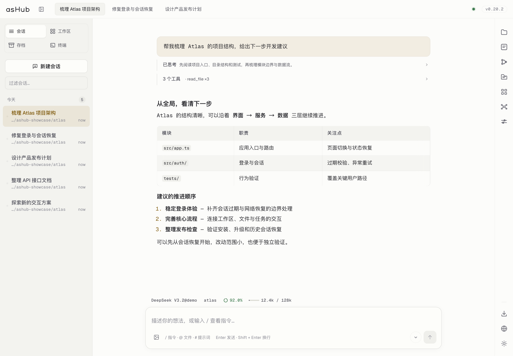
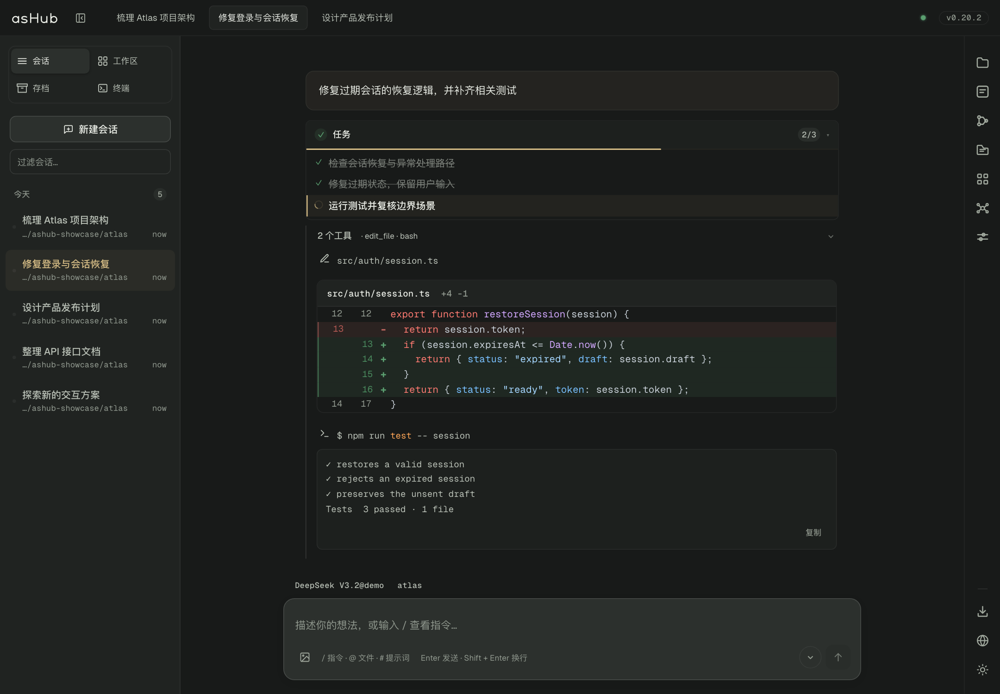
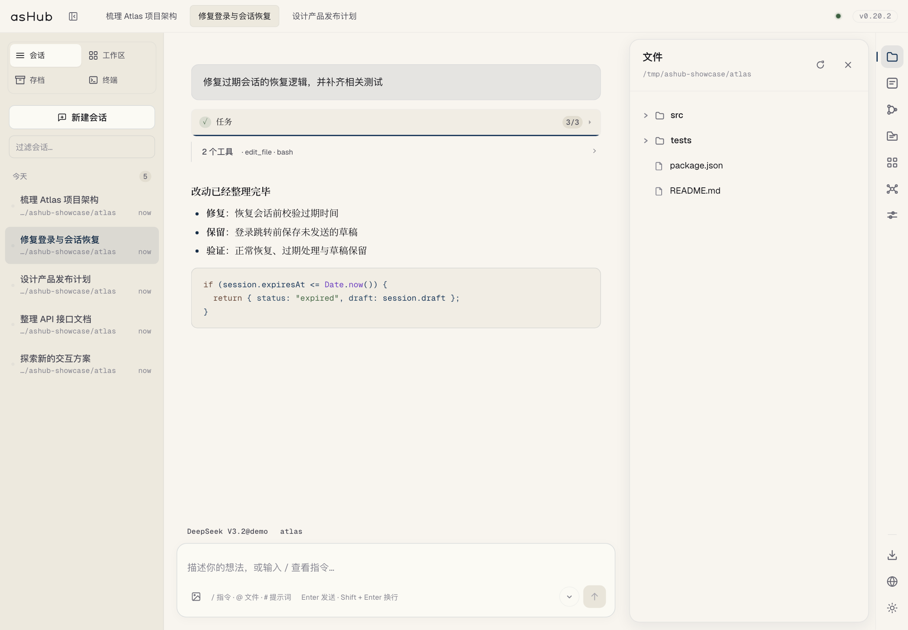

<p align="center"></p>
<h1 align="center">asHub</h1>
<p align="center">A quiet workspace for ambitious ideas</p>
<p align="center"><a href="https://ashub.aihao.world">Website & downloads</a> · <a href="https://github.com/firslov/asHub/releases">Releases</a> · <a href="README.md">English</a> · <a href="README_CN.md">简体中文</a></p>

[](LICENSE)
[](.nvmrc)
[](https://github.com/guanyilun/agent-sh/releases/tag/v0.16.0)

asHub is an open-source desktop workspace powered by [agent-sh](https://github.com/guanyilun/agent-sh). Keep conversations, models, subagents, terminals and project files together, with a readable result and an inspectable execution trail.

Available for **macOS (Apple Silicon / Intel), Windows x64 and Linux x64**. The desktop app and local browser view share the same client. Connect your own model provider with API credentials or supported Codex sign-in; provider billing and plan limits apply.



*Screenshots show the real v0.20.2 interface with an isolated demo project and illustrative conversations. No personal conversations or API credentials are included.*

## Highlights

These features describe the current source branch. Project collaboration, Codex sign-in and per-model thinking controls are not included in the v0.20.5 packages.

| Capability | Experience |
| --- | --- |
| Sessions & projects | Group conversations into projects; switch views, search, pin, archive and restore history |
| Conversation collaboration | Send tasks within a project, follow receipts and read results; optional Git worktrees keep file changes separate |
| Readable execution | Replies and progress first; thinking and tool output stay in expandable details |
| Tasks & subagents | Task progress and five specialists: plan, explore, review, research and implement; configurable models and budgets |
| Models & context | Codex sign-in, model search and native thinking levels; inspect context and reported cache usage |
| Reviewable actions | Permission prompts, change previews, session-wide approval and background notifications |
| Project tools | PTY terminals, file browsing, image input, a skills marketplace and user extensions |
| Persistent work | Saved conversations, branches, rewind, Markdown export and downloadable workspace results |
| A consistent interface | Gruvbox light and dark themes; English and Chinese; display scaling and a collapsible status bar |
| Mobile access · preview | Continue authorized desktop conversations from a phone; shared history, streaming replies and one-time approvals |

<details>
<summary>Execution detail: tasks, code changes and tool output</summary>



</details>

<details>
<summary>Project files</summary>



</details>

## Install & get started

Download from the [website](https://ashub.aihao.world/#download) or [GitHub Releases](https://github.com/firslov/asHub/releases/latest). Desktop packages include their runtime; no separate Node.js installation is needed.

| Platform | Package |
| --- | --- |
| macOS Apple Silicon | `arm64.dmg` |
| macOS Intel | `x64.dmg` |
| Windows x64 | `Setup.exe` |
| Linux x64 | `.AppImage` |

1. Install and open asHub
2. Configure your provider and default model in the right panel; source builds also support Codex sign-in
3. Create a session, choose a project directory and start a conversation; open files, terminals and other panels as needed

### macOS one-line install

```sh
curl -fsSL https://raw.githubusercontent.com/firslov/asHub/main/install.sh | bash
```

The script detects Apple Silicon or Intel, installs to `/Applications` and removes the quarantine flag. If a manually installed DMG is blocked, choose **Open Anyway** in **System Settings → Privacy & Security**, or run:

```sh
/usr/bin/xattr -dr com.apple.quarantine "/Applications/asHub.app"
```

### Linux

After downloading the AppImage, run these commands in its directory:

```sh
chmod +x ./asHub-*.AppImage
./asHub-*.AppImage
```

## Mobile access · preview

Continue desktop conversations at [asHub Mobile](https://ashub.aihao.world/mobile/). **Requires asHub v0.20.5 or later.**

1. Open **Mobile Access (移动访问)** in the desktop toolbar, sign in or create an account, and authorize project directories
2. Save the recovery code, then select **I have saved it (我已保存)**. Unconfirmed codes survive menu switches, but must be saved before quitting or refreshing the app
3. Sign in with the same account on your phone, select your computer, and continue a conversation or start a new one

Keep the computer awake and asHub running. Only conversations in authorized, existing directories are shared; restore archived conversations on the desktop first. Mobile supports streamed replies, images, model switching and one-time approvals. The relay forwards content without persisting conversation bodies; it is not end-to-end encrypted.

Project views, task receipts, result downloads and thinking controls have also been adapted locally for mobile. They require matching desktop and gateway updates and are not yet deployed to the hosted mobile site.

## Run from source

The project pins **Node.js 22.23.3** (minimum **22.12.0**) and **agent-sh 0.16.0**, including the upstream Unicode fix and built-in Codex provider. With nvm:

```sh
git clone https://github.com/firslov/asHub.git
cd asHub
nvm install && nvm use
npm ci
npm run electron:dev
```

For a local browser-only server:

```sh
npm start -- --port 7878
# Open http://localhost:7878
```

### Access from another device

```sh
npm start -- --host 0.0.0.0 --port 7878
```

The default bind address is `127.0.0.1`. Non-loopback access requires a token: startup prints a generated token, which you enter at `/auth`. Set `ASHUB_TOKEN` for a persistent token; API clients can send `Authorization: Bearer <token>`. Use a trusted network or an HTTPS reverse proxy.

Conversation history is stored locally. When using a cloud model, relevant request content is sent to your configured provider. ACP session restoration depends on the backend's `session/load` capability. When unsupported, or when a legacy session has no remote ID, history remains readable but you must create a new session to continue.

## How it works

`src/hub.ts` is the core: a **bridge-agnostic** HTTP + SSE server that spawns and supervises one
*bridge* per session. Whatever runs the conversation just has to emit `BusEvent`s and implement
`submit` / `cancel` / `close` — see [`src/bridges/types.ts`](src/bridges/types.ts).

```
Electron shell (electron/main.cjs)          browser (any modern browser)
        │                                             │
        └──────────────► hub (src/hub.ts) ◄───────────┘
                     one HTTP port, path routing /<id>/events, /<id>/submit
                                 │
        ┌────────────────────────┼────────────────────────┐
        ▼                        ▼                        ▼
   AshBridge               AcpBridge               TerminalBridge
   agent-sh kernel         child process           PTY shell
   in-process              speaking ACP            (node-pty)
```

| Bridge | Runs | Selected by |
|---|---|---|
| `AshBridge` | agent-sh's kernel in-process — no subprocess, one less hop | default (`--backend ash`) |
| `AcpBridge` | a child process speaking ACP, e.g. `agent-sh-acp` or `claude-code-acp` | `--backend acp [--cmd "CMD ARGS"]` |
| `TerminalBridge` | a PTY shell session (agent-sh's shell or a plain terminal) | session kind `terminal` |

Adding a backend therefore means implementing one interface; the hub, the SSE protocol, and the
web client stay untouched.

## Command line

These flags apply to `ashub` / `npm start`. The Electron app starts the same hub in-process with
its defaults.

| Flag | Default | Description |
|---|---|---|
| `--backend ash\|acp` | `ash` | Bridge implementation: in-process agent-sh kernel, or an ACP subprocess |
| `--cmd "CMD ARGS"` | `agent-sh-acp` | Spawn command for `--backend acp` (double quotes are honoured) |
| `--port N` | `7878` | HTTP port |
| `--host HOST` | `127.0.0.1` | Bind address |
| `--web PATH` | `./web` | Static web root |
| `--model NAME` | settings default | Model override (ash backend) |
| `--provider NAME` | settings default | Provider override (ash backend) |
| `-h`, `--help` | — | Show usage |

```sh
# in-process kernel (default)
ashub --port 8080

# spawn Claude Code's ACP server instead
ashub --backend acp --cmd "claude-code-acp"
```

## Project layout

```text
src/                  HTTP/SSE server, session lifecycle, history and permissions
  bridges/            agent-sh / ACP / PTY bridge implementations
  history/            History store, frame capture and context compaction
web/                  Plain ES modules and CSS; no frontend build step
  js/stream/          Thinking, tools, tasks, replies and live output renderers
  assets/brand/       Shared icons, mark and vector wordmark
electron/             Desktop window, IPC, auto-update and application icons
website/              Homepage, download template, fonts and app screenshots
scripts/              Build helpers and showcase capture
tests/                Isolated regressions, HTTP and kernel compatibility checks
examples/extensions/  Example extensions
```

## Development & validation

| Command | Purpose |
| --- | --- |
| `npm run build` | Compile backend TypeScript into `dist/` |
| `npm run typecheck` | Backend type checking |
| `npm run typecheck:web` | Frontend project checking |
| `npm test` | Isolated regression suite |
| `npm run test:http` | HTTP and session endpoint checks |
| `npm run test:kernel` | Build and check kernel and Codex compatibility |
| `npm run test:network` | Proxy and network behavior |
| `npm run test:worktrees` | Isolated Git worktree behavior |
| `npm run electron:pack` | Create an unpacked desktop app |
| `npm run electron:dist:mac` | Build macOS packages |
| `npm run electron:dist:win` | Build Windows packages |

Electron loads compiled `dist/`; the CLI runs source via `tsx`. Frontend libraries are vendored, so interface resources need no external CDN. Regression tests use temporary data and mocked boundaries, without model calls or access to real API credentials.

Install skills through the built-in marketplace. Extensions load from `~/.agent-sh/extensions/` and support TypeScript; see the [extension example](examples/extensions/wechat-bot). HTTP routes live in [`src/hub.ts`](src/hub.ts); the backend contract lives in [`src/bridges/types.ts`](src/bridges/types.ts).

## License

[MIT](LICENSE)
